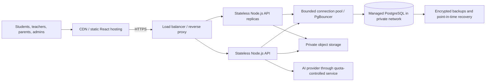
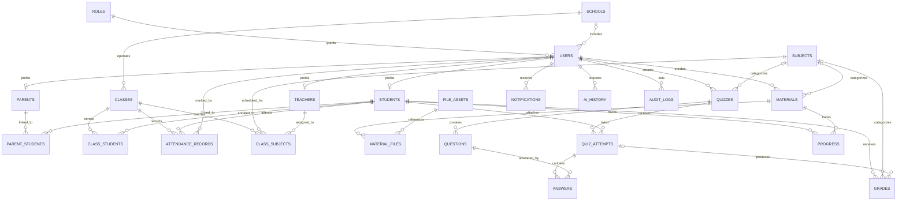

# EDU BRIDGE Database and API Plan

Status: design only. The current React frontend uses local mock data. No database, backend, authentication provider, AI provider, or file-storage service is connected.

## Proposed architecture

- PostgreSQL is the source of truth; Prisma migrations are the planned schema-change mechanism.
- Express and TypeScript expose a versioned REST API at `/api/v1`.
- The React client never connects directly to PostgreSQL or stores secrets.
- Uploaded files live in private object storage. PostgreSQL stores metadata and object keys, not file bytes.
- `school_id` scopes school-owned records. Global platform administrators are explicitly scoped and audited.

## Production topology and scaling



### Local development versus production

- PostgreSQL on the developer's computer is for local development and test data only. It must not be the public production database and port `5432` must not be opened to the internet.
- End users never connect to PostgreSQL. Their browser calls the HTTPS API; only the backend reaches the database over a private network or a strict provider firewall rule.
- Production uses a separate managed PostgreSQL instance, credentials, backups, and network policy. Staging also has its own database and contains no unapproved real student data.
- Keep `DATABASE_URL` out of source control and frontend bundles. Use local ignored environment files for development and a secret manager for deployed services. Use TLS for database connections.
- Keep user uploads in private object storage. Apply per-file size/type limits, malware scanning, signed short-lived upload/download URLs, quotas, and lifecycle rules. A database row stores the object key and metadata, not the document bytes.

### Many users and connection limits

The number of registered users is not the number of PostgreSQL connections. Thousands of people can use the app while a much smaller, bounded number of API workers share database connections. The backend owns those connections; never create a database connection from React or one connection per HTTP request.

Set a maximum pool size for each API process and budget it across every replica:

```text
API replicas × pool maximum per replica
+ background worker pools
+ migration/admin reserve
<= safe database connection budget
```

For example, 4 API replicas with a maximum pool of 8 can open up to 32 application connections, before workers and operational reserve. This is an illustration, not a recommended fixed setting; calculate it from the selected database plan's connection limit and load-test results. If the service has built-in pooling, or PgBouncer is introduced, configure the Prisma/app and external pool together and validate migration connections separately.

Do not treat “too many connections” by endlessly raising `max_connections`. First inspect API replica count, pool settings, leaked/idle transactions, and pool wait time. Keep transactions short, set statement/transaction timeouts, and return a controlled `503`/`429` when the service is at capacity. Retry only transient failures with bounded backoff; writes need idempotency before they can safely be retried.

### Database full, slow, or blocked

These are different failure modes and need different responses:

| Symptom | Detect | First response |
| --- | --- | --- |
| Storage near limit | Provider storage metrics, growth rate, alerts | Alert before the hard limit (for example warn at 70%, urgent at 85%); inspect table/index growth and retention, then increase managed storage before exhaustion |
| Connection saturation | Active connections, pool wait/timeout rate, API replica count | Check pool multiplication and idle transactions; scale API replicas only if the database connection budget allows it; add pooling where appropriate |
| Slow queries / high CPU or I/O | Query latency percentiles, database CPU/I/O, slow-query or query-statistics views | Find the top expensive queries, add measured indexes, paginate, remove N+1 calls, avoid unbounded result sets, and load-test the change |
| Lock waits / deadlocks | Lock/wait metrics, deadlock reports, long transactions | Keep transactions short, use consistent update order, index predicates, and retry only idempotent transactions with bounded backoff |
| Lost or corrupted data | Backup/restore drills and audit events | Restore to a separate database using point-in-time recovery, verify it, then use a planned cutover; do not overwrite the only copy |
| File storage growth | Object-storage usage and upload metrics | Enforce quotas and lifecycle/retention policies; move files out of the database rather than expanding database storage for file bytes |

Storage auto-growth can provide headroom only when the chosen provider/plan supports it; it does not replace alerts, capacity review, and a tested recovery plan. Do not delete grades, answers, or audit history as an emergency space fix. Define retention and archival rules before production, with school/privacy requirements approved.

### Scale-up sequence

1. Establish baseline metrics and a realistic load test for concurrent reads, quiz submissions, file uploads, and AI requests.
2. Tune indexes and query shape, pagination, payload size, caching of safe read-only catalog data, and bounded connection pools.
3. Increase managed PostgreSQL CPU/memory/storage when measurements show a database resource limit; increase API replicas when the API tier is the limit.
4. Add read replicas only for read-heavy endpoints that can tolerate replication lag. Keep authorization-sensitive writes and immediate read-after-write behavior on the primary unless the product explicitly handles lag.
5. Consider partitioning high-volume time-series/audit data or archival only after measured growth justifies the operational complexity.
6. Add Redis only for a measured cache, rate-limit, or ephemeral-state need; it is not a fix for missing indexes or unbounded queries.

There is no reliable user-count threshold that guarantees capacity. Concurrent activity, query cost, file volume, quiz bursts, and AI traffic determine the required plan. Run load tests against a staging environment sized like production, set alerts for storage/connections/CPU/latency/error rate, and rehearse a restore before launch.

## ERD



`o|` is optional/zero-or-one. All primary keys are UUIDs unless a composite key is noted. Timestamps are UTC.

## Tables

| Table | Important fields and constraints |
| --- | --- |
| `roles` | `id`, unique `code` (`student`, `teacher`, `parent`, `admin`), `name` |
| `schools` | `id`, unique `code`, `name`, `status`, timestamps |
| `users` | `id`, `role_id`, nullable `school_id`, normalized unique `email`, `password_hash`, `status`, `locale`, timestamps |
| `students` | `user_id` PK/FK, `student_number`, `grade_level` |
| `teachers` | `user_id` PK/FK, `employee_number`, `verification_status` |
| `parents` | `user_id` PK/FK, contact fields |
| `parent_students` | `parent_user_id`, `student_user_id`, `relationship`, `verified_at`; composite PK, verified link required for child access |
| `classes` | `id`, `school_id`, `name`, `grade_level`, `school_year`, `homeroom_teacher_user_id`, timestamps |
| `class_students` | `class_id`, `student_user_id`, `enrolled_at`; composite PK |
| `attendance_records` | `id`, `class_id`, `student_user_id`, `marked_by_user_id`, `attendance_date`, `status`, `note`, `created_at`; unique (`class_id`, `student_user_id`, `attendance_date`) |
| `subjects` | `id`, nullable `school_id` for platform-wide catalog, `code`, `name`; use one unique index on `code` where `school_id IS NULL` and another on (`school_id`, `code`) where `school_id IS NOT NULL` because PostgreSQL treats NULL values as distinct in ordinary unique constraints |
| `class_subjects` | `class_id`, `subject_id`, `teacher_user_id`; composite PK over class and subject assignment |
| `file_assets` | `id`, `owner_user_id`, private `storage_key`, `original_name`, `mime_type`, `size_bytes`, checksum, scan status |
| `materials` | `id`, `school_id`, `created_by_user_id`, nullable `subject_id`, `title`, `description`, `visibility`, `status`, timestamps |
| `material_files` | `material_id`, `file_asset_id`, `position`; composite PK |
| `quizzes` | `id`, `school_id`, `created_by_user_id`, nullable `subject_id`/`class_id`, `title`, `status`, `available_from`, `available_until` |
| `questions` | `id`, `quiz_id`, `type`, `prompt`, `options` JSONB for structured choices, `points`, `position` |
| `quiz_attempts` | `id`, `quiz_id`, `student_user_id`, `started_at`, `submitted_at`, `status`, `score`; index by quiz/student |
| `answers` | `id`, `attempt_id`, `question_id`, `response` JSONB, `score`, `feedback`; unique (`attempt_id`, `question_id`) |
| `grades` | `id`, `student_user_id`, `subject_id`, nullable `class_id`/`quiz_attempt_id`, `score`, `max_score`, `graded_by_user_id`, timestamps |
| `progress` | `id`, `student_user_id`, `material_id`, `percent_complete`, `last_position`, `updated_at`; unique (`student_user_id`, `material_id`) |
| `notifications` | `id`, `user_id`, `type`, `title`, `body`, `read_at`, `created_at`; index by (`user_id`, `created_at`) |
| `ai_history` | `id`, `user_id`, `feature`, `request_id`, token counts, `status`, `created_at`; do not store sensitive prompts by default |
| `audit_logs` | `id`, `actor_user_id`, `school_id`, `action`, `entity_type`, `entity_id`, minimal metadata JSONB, `created_at` |

Use foreign keys with explicit delete behavior. Prefer soft deactivation for accounts, schools, materials, and quizzes that have history. Keep unique constraints and tenant-scoped indexes in migrations.

## Access rules

| Role | Scope |
| --- | --- |
| Student | Own profile, own attempts/grades/progress, materials published to their school/class |
| Teacher | Assigned classes and subjects, enrolled students in those classes, own materials/quizzes, grading for assigned classes |
| Parent | Only students linked by a verified `parent_students` record; read-only progress, attendance/grades, and approved notices |
| Admin | School-scoped management; platform admin access must be a separate explicit permission and audited |

Enforce these rules in backend authorization and queries for every object. Hiding a link in React is only a usability measure, not security. Do not accept `school_id`, role, owner, or student identity from an untrusted client without checking it against the authenticated session.

## API contract

Prefix all endpoints with `/api/v1`. JSON is UTF-8. List endpoints use `?page=1&pageSize=20&sort=-createdAt`; cap page size. Return a consistent error envelope:

```json
{
  "error": {
    "code": "VALIDATION_ERROR",
    "message": "Request validation failed",
    "fields": { "email": "Invalid email" },
    "requestId": "uuid"
  }
}
```

### Authentication and account

| Method | Route | Access / purpose |
| --- | --- | --- |
| `POST` | `/auth/register` | Public; validate invite/school policy, hash password, create pending or active account |
| `POST` | `/auth/login` | Public; issue rotated `HttpOnly`, `Secure`, `SameSite` session cookie |
| `POST` | `/auth/logout` | Authenticated; revoke session and clear cookie |
| `GET` | `/auth/me` | Authenticated; return safe profile and role claims |
| `POST` | `/auth/forgot-password` | Public, rate-limited; send a single-use reset token without account enumeration |
| `POST` | `/auth/reset-password` | Public with valid single-use token; update Argon2id password hash and revoke sessions |
| `PATCH` | `/users/me` | Authenticated; update allow-listed profile fields |

### Platform resources

| Method | Route | Access / purpose |
| --- | --- | --- |
| `GET/POST` | `/schools` | Admin list/create; scoped to authorized platform/school admin |
| `GET/PATCH` | `/schools/:schoolId` | Admin; enforce tenant scope |
| `GET/POST` | `/classes` | Teacher/admin; list or create within school scope |
| `GET/PATCH` | `/classes/:classId` | Assigned teacher/admin; details and updates |
| `POST/DELETE` | `/classes/:classId/students` | Admin/authorized teacher; enrollment changes |
| `GET/POST` | `/subjects` | Read catalog; admin manages school-specific subjects |
| `GET/POST` | `/materials` | List published/authorized items; teacher/admin creates draft |
| `GET/PATCH/DELETE` | `/materials/:materialId` | Owner or authorized admin; publish/archive with audit |
| `GET/POST` | `/quizzes` | Teacher/admin list and create within assigned scope |
| `GET/PATCH` | `/quizzes/:quizId` | Creator/authorized admin; edit draft or publish |
| `POST` | `/quizzes/:quizId/attempts` | Student enrolled in target class; start an attempt |
| `PUT` | `/attempts/:attemptId/answers/:questionId` | Owning student while attempt is open; idempotent answer save |
| `POST` | `/attempts/:attemptId/submit` | Owning student; submit once and score eligible question types |
| `GET` | `/students/me/progress` | Student self; parent only with verified relationship; teacher only for assigned class |
| `GET` | `/attendance` | Student self; verified parent for linked child; teacher/admin within authorized class/school scope |
| `POST` | `/classes/:classId/attendance` | Assigned teacher/admin; create or upsert daily attendance for enrolled students |
| `GET` | `/grades` | Student/verified parent read; teacher sees assigned classes; admin sees authorized school scope |
| `PATCH` | `/grades/:gradeId` | Assigned teacher/admin; record grader and audit event |
| `GET` | `/notifications` | Authenticated user's notifications only |
| `PATCH` | `/notifications/:notificationId` | Owner only; mark read |
| `POST` | `/files/upload-intents` | Authenticated role with upload permission; returns short-lived private upload URL |
| `POST` | `/ai/tutor` | Authenticated; enforce role, daily quota, rate limit, and usage logging |
| `GET` | `/ai/usage` | User's own usage; admin only for authorized aggregate scope |

Use `201` for creation, `204` for successful no-content actions, `400/422` for invalid input, `401` for no session, `403` for insufficient permission, `404` for inaccessible or missing records, `409` for conflicts, `429` for quotas, and `500` only with a request ID and no sensitive internals.

## Security and operations decisions

- Hash passwords with Argon2id; never store or log plain passwords or reset tokens.
- Prefer server-side sessions in secure, HttpOnly cookies. Protect state-changing requests with CSRF defenses and strict CORS; do not put long-lived JWTs in `localStorage`.
- Validate all request bodies, query parameters, upload MIME/size, and ownership on the server. Scan uploads and serve them through authorized signed URLs.
- Apply tenant and object-level authorization on every query. Add rate limits to authentication, search, uploads, and AI routes.
- Keep AI provider keys server-side; enforce per-role/day budgets, request timeouts, input-size limits, and minimal retention.
- Back up PostgreSQL with encrypted, tested restore procedures. Monitor migration status, errors, latency, storage, and AI usage.

## Implementation order after this design

1. Review and approve this model and retention/privacy requirements.
2. Initialize the TypeScript Express service and Prisma schema/migrations.
3. Implement session authentication and authorization tests before exposing protected data.
4. Add school, class, subject, and material APIs; then quizzes, answers, grades, progress, and notifications.
5. Connect React through a typed API client and replace mock data one feature at a time.
6. Add AI/file services behind quotas and storage controls; then run security, accessibility, load, and backup-restore tests.